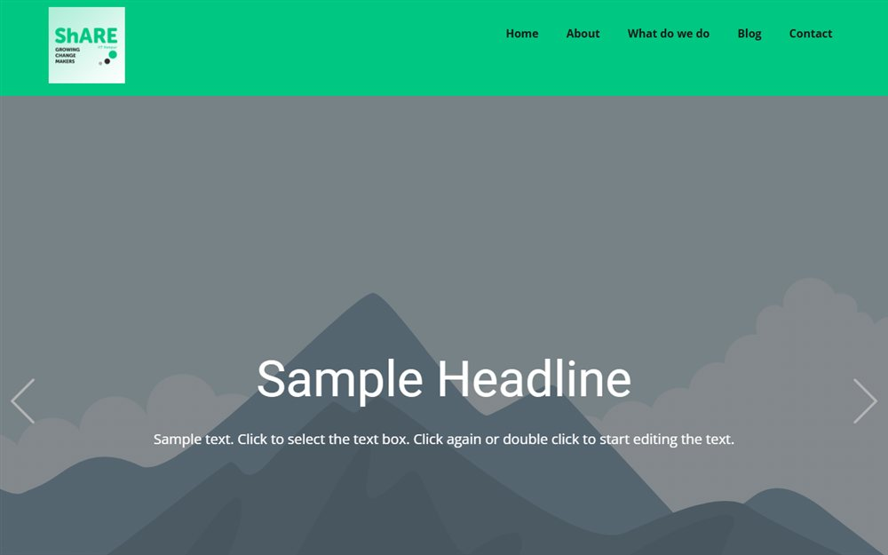

# Blog Share

A single-page blog template: hero, post list and article layout in plain HTML and CSS.

**[Open the live site](https://ajeet-iitk.github.io/blog_share_1/)**

## What it does

A blog template built from static templates - a landing view, a post view, and a password-gated page template. Content is plain HTML, so it can be hosted anywhere without a build step.

## Features

- Separate templates for the blog index and a single post
- Password page template for gated posts
- Image assets included
- jQuery only for small interactions

## Run locally

Open `index.html`, or use the hosted copy:

<https://ajeet-iitk.github.io/blog_share_1/>

## Files

| File | Purpose |
| --- | --- |
| `index.html` | Blog landing page |
| `Blog-Template.css`, `Post-Template.css` | Post styling |
| `Page-Password-Template.css` | Gated page styling |

---

Part of [my collection of small projects](https://github.com/Ajeet-iitk).
